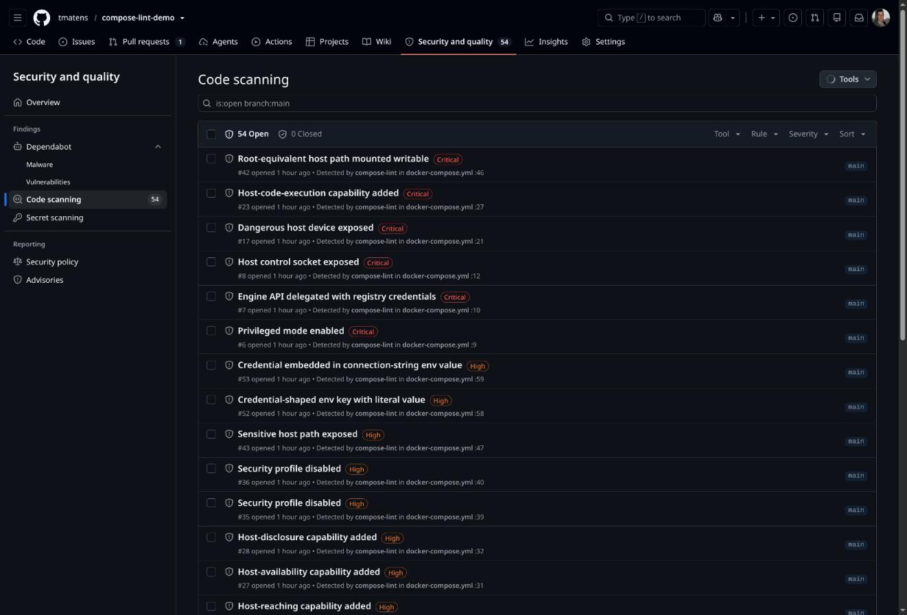
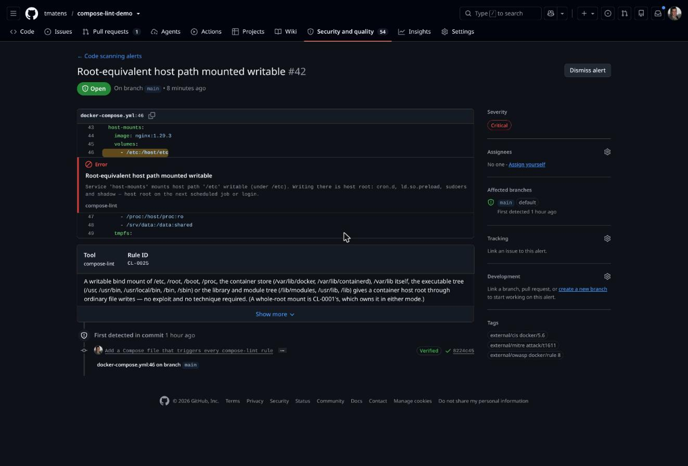
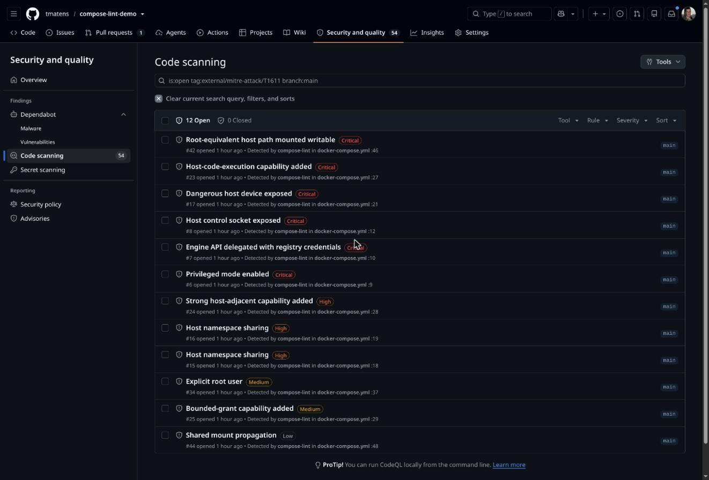

# compose-lint demo

A deliberately insecure `docker-compose.yml` that triggers every rule in
[compose-lint](https://github.com/tmatens/compose-lint), with a workflow that
sends the findings to GitHub Code Scanning.

Do not run the Compose file. Several of its services would give a container
control of the host.

## What it shows

- `docker-compose.yml` has six small services, each grouping related
  misconfigurations: host control, host namespaces and devices, added
  capabilities, disabled security profiles, host mounts, and a web service
  with credentials in its environment.
- `.github/workflows/compose-lint.yml` runs the compose-lint GitHub Action on
  every push to `main` and uploads a SARIF file.
- The findings appear under **Security > Code scanning**. With compose-lint
  1.6.0 the file produces 54 findings across all 28 rules.

## What the findings look like

GitHub shows code scanning alerts only to people with write access to a
repository, so the screenshots below are from this repository's Security tab.

The alert list, most severe first:



One alert. It marks the line in the Compose file, explains the finding, and
lists the standards the rule relates to under **Tags**:



## Filtering by standard

Each compose-lint rule is tagged with the CIS Docker Benchmark controls,
OWASP Docker Security Cheat Sheet rules and MITRE ATT&CK techniques it
relates to. Type a tag into the search box to filter the alert list.

`tag:external/mitre-attack/T1611` shows the twelve findings that relate to
the Escape to Host technique:



Other examples:

| Filter | Shows findings that relate to |
|---|---|
| `tag:external/cis-docker/5.4` | CIS Docker Benchmark 5.4, restricting Linux kernel capabilities |
| `tag:external/owasp-docker/rule-8` | OWASP Docker Security Rule 8, read-only filesystem and volumes |
| `tag:external/mitre-attack/T1552.001` | MITRE ATT&CK T1552.001, credentials in files |

A tag says the rule relates to the control or technique. It does not mean a
file with no findings complies with the benchmark. The full mapping is on
compose-lint's
[standards mapping](https://tmatens.github.io/compose-lint/standards/) page.

## See it on your own copy

Fork this repository, enable Actions on the fork, and run the **Compose
Lint** workflow. The alerts then appear in your fork's Security tab.

## Run it locally

```bash
pip install compose-lint
compose-lint docker-compose.yml
```

## Workflow notes

The lint step uses `continue-on-error: true` because the file is meant to
fail. A real project would leave that out so that a finding at or above
`fail-on` fails the job.

The images in `docker-compose.yml` are left unpinned on purpose, and
Renovate is configured not to update them. It does keep the two GitHub
Action pins current.
